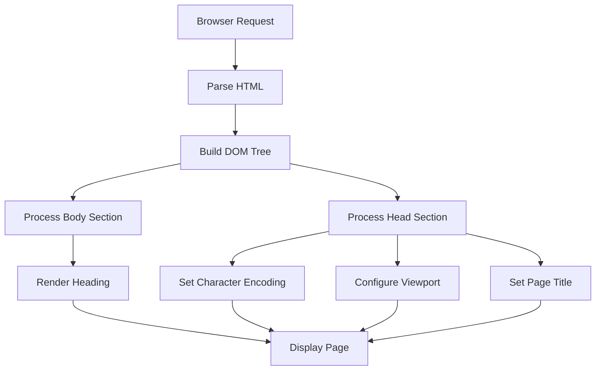
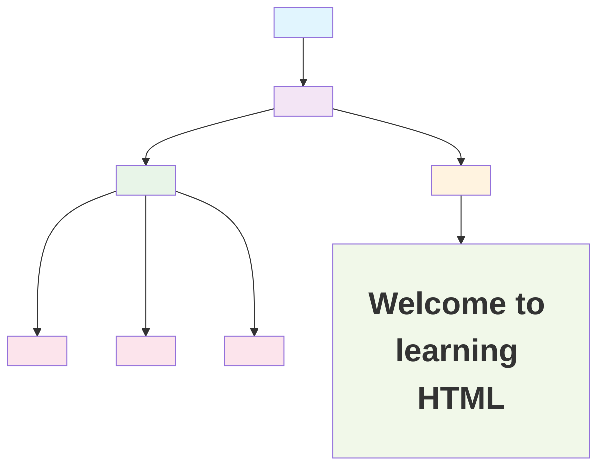

# HTML Hello World Document

A simple HTML5 document that serves as a basic template for learning HTML structure and elements.

## Table of Contents

- [Overview](#overview)
- [File Structure](#file-structure)
- [Code Explanation](#code-explanation)
- [HTML Document Flow](#html-document-flow)
- [Element Hierarchy Diagram](#element-hierarchy-diagram)
- [How It Works](#how-it-works)
- [Usage](#usage)

## Overview

This is a minimal HTML5 document that demonstrates the basic structure of a web page. It includes essential elements like the document type declaration, head section with metadata, and a body with a heading.

## File Structure

```
Frontend/HTML/
├── hello.html       # Main HTML file
└── README.md        # This documentation file
```

## Code Explanation

```html
<!doctype html>
<!-- Declares the document type as HTML5 -->
<html lang="en">
  <!-- Root element of the HTML document; lang="en" sets the language to English -->
  <head>
    <!-- Container for metadata, title, and other non-visible document information -->
    <meta charset="UTF-8" />
    <!-- Sets the character encoding to UTF-8, supporting all Unicode characters -->
    <meta name="viewport" content="width=device-width, initial-scale=1.0" />
    <!-- Configures responsive viewport for proper mobile rendering -->
    <title>Document</title>
    <!-- Sets the title of the document, displayed in the browser tab -->
  </head>
  <!-- Closes the head section -->
  <body>
    <h1>Welcome to learning HTML</h1>
  </body>
  <!-- Container for all visible page content (text, images, links, etc.) -->
</html>
<!-- Closes the root HTML element -->
```

### Element Breakdown

| Element/Attribute        | Purpose                                                             |
| ------------------------ | ------------------------------------------------------------------- |
| `<!doctype html>`        | Declares the document type as HTML5                                 |
| `<html lang="en">`       | Root element of the HTML document; sets language to English         |
| `<head>`                 | Container for metadata, title, and non-visible document information |
| `<meta charset="UTF-8">` | Sets character encoding to UTF-8 for Unicode support                |
| `<meta name="viewport">` | Configures responsive viewport for mobile devices                   |
| `<title>`                | Sets the document title shown in the browser tab                    |
| `<body>`                 | Container for all visible page content                              |
| `<h1>`                   | Top-level heading displayed on the page                             |

## HTML Document Flow



## Element Hierarchy Diagram



## How It Works

1. **Document Type Declaration**: The `<!doctype html>` declaration tells the browser that this is an HTML5 document, ensuring standards mode rendering.

2. **Root Element**: The `<html>` element is the root of the document, with `lang="en"` specifying English as the primary language.

3. **Head Section**: Contains metadata that doesn't appear directly on the page:
   - **Character Encoding**: UTF-8 supports all Unicode characters, ensuring proper display of text in any language.
   - **Viewport Configuration**: Makes the page responsive by setting the width to the device width and initial scale to 1.0.
   - **Title**: Sets the text displayed in the browser tab.

4. **Body Section**: Contains all visible content:
   - The `<h1>` element displays the main heading "Welcome to learning HTML".

## Usage

1. Open `hello.html` in any modern web browser (Chrome, Firefox, Safari, Edge).
2. You will see a page with the heading "Welcome to learning HTML".
3. The browser tab will display "Document" as the page title.

## Learning Resources

- [MDN Web Docs - HTML](https://developer.mozilla.org/en-US/docs/Web/HTML)
- [W3Schools HTML Tutorial](https://www.w3schools.com/html/)
- [HTML5 Specification](https://html.spec.whatwg.org/)
